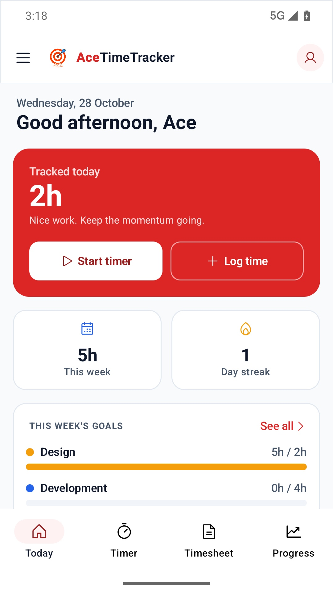
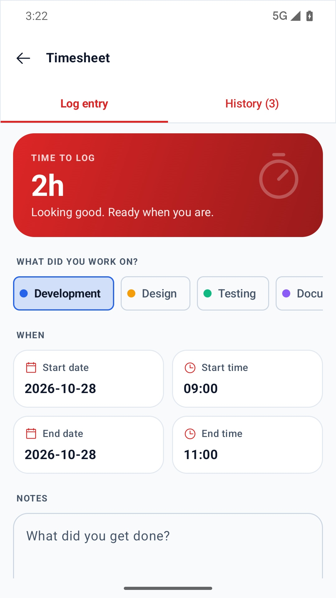
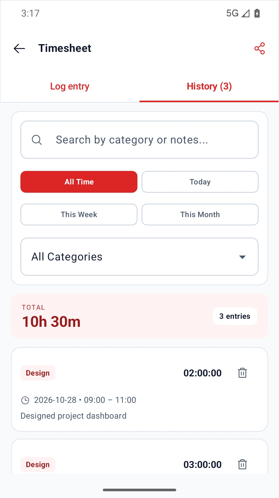
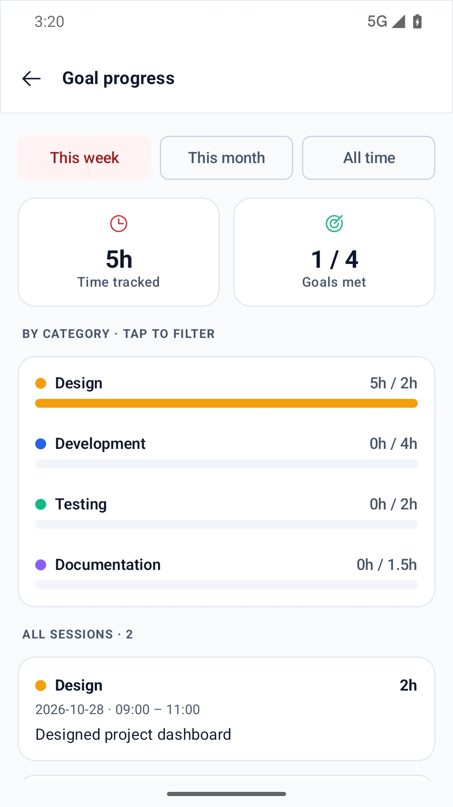

<p align="center">
  
</p>

<h1 align="center">AceTimeTracker</h1>
<p align="center">Track your work. Make time for what matters.</p>

<p align="center">
  <a href="https://github.com/MphoCodes/AceTimeTracker/actions/workflows/android.yml"></a>
  <a href="LICENSE"></a>
  
  
</p>

A native Android time tracker built with Kotlin and Jetpack Compose. Record a focused session or add time manually, organize it by category, and see where your week went.

## A look inside

<p align="center">
  
  
  
  
</p>

Screenshots show the demo interface captured in October 2026; they are illustrative, not evidence of a live backend or store release.

## What you can do

- **Track a session:** stopwatch or Pomodoro focus/break cycles, category selection, pause, reset, and save. Only focus time contributes to a Pomodoro entry.
- **Keep a timer draft:** leaving the timer pauses it and preserves a draft per account on the device. After process loss, the most recent checkpoint is restored paused; time after that checkpoint is not inferred.
- **Log time manually:** date-aware start/end validation, notes, and an optional photo.
- **Organize work:** create colored categories with hour targets and optional minimum/maximum goals; delete categories while retaining historical entries.
- **Review progress:** daily and weekly totals, category breakdowns, history filtering, and entry deletion.
- **Share a report:** export the selected history as CSV text through Android's share sheet, with quoting and spreadsheet formula protection.
- **Manage your profile:** email/password sign-in, registration, password reset, and profile details/photo.
- **Choose your appearance:** light, dark, or system theme.

## Try it locally

1. Clone the repository and open it in Android Studio.
2. Configure **JDK 21** and the SDK packages in the [development guide](docs/development.md).
3. Build and install the debug variant:

   ```sh
   ./gradlew :app:assembleDebug
   ./gradlew :app:installDebug
   ```

4. Use the **test sign-in** option on the login screen to explore with local sample data.

The demo does not need a live Firebase backend. Its sample categories, profile, and saved entries are held in memory and reset when the process restarts. Timer drafts and appearance preferences persist locally. Test sign-in is disabled in release builds.

For real accounts, configure a Firebase project you control. The checked-in debug configuration is a placeholder; see [Firebase setup and data boundaries](docs/development.md#firebase-setup).

## Engineering

The app uses Compose Material 3 screens, activity-based navigation, ViewModels for screen state, and repositories for Firebase access. Time is stored in milliseconds; the timer measures elapsed time with a monotonic clock. Dashboard and chart totals are derived from the same timesheet entries.

```text
app/src/main/java/com/example/acetimetracker/
├── data/model/        Categories, profiles, and timesheet entries
├── data/repository/   Authentication, Firebase access, settings, aggregation
├── ui/activity/       Android lifecycle and navigation
├── ui/screen/         Compose screens
├── ui/components/     Shared controls and dialogs
├── ui/viewmodel/      Validation and screen state
├── ui/theme/          Color, typography, and theme preference
├── service/           Active timer notification
└── util/              Time calculations, CSV export, and result types
```

The project retains some XML layouts and adapters from its earlier UI. This is an incremental modernization, not a claim that every legacy component has been removed. See [architecture](docs/architecture.md).

## Build and verify

```sh
./gradlew --console=plain :app:testDebugUnitTest :app:lintDebug :app:assembleDebug
./gradlew --console=plain :app:lintRelease :app:assembleRelease :app:bundleRelease
```

GitHub Actions builds debug and release artifacts, runs local tests and lint, and retains reports. Device tests are a separate check:

```sh
./gradlew :app:connectedDebugAndroidTest
```

See [release preparation](docs/release.md) for output paths, optional signing, and remaining publication requirements. Builds are unsigned unless release signing is explicitly configured.

## Project status

The current time-tracking workflows are implemented, with local regression coverage for time calculations, aggregation, release authentication boundaries, photo failures, timer recovery, goal validation, and CSV export.

Live Firebase ownership/rules, production authentication and media flows, account deletion, privacy disclosures, and store submission still require release-owner verification. There is no claim of a published Play release. The larger goals/routines, durable offline synchronization, and reminders roadmap in `docs/superpowers/` is future work, not a list of shipped features.

## Contributing

Bug reports and focused pull requests are welcome. Start with [CONTRIBUTING.md](CONTRIBUTING.md), include reproduction steps, and keep screenshots free of personal data. Report security issues using [SECURITY.md](SECURITY.md).

Built by [Mpho Ndlela](https://github.com/MphoCodes). Licensed under the [MIT License](LICENSE).
