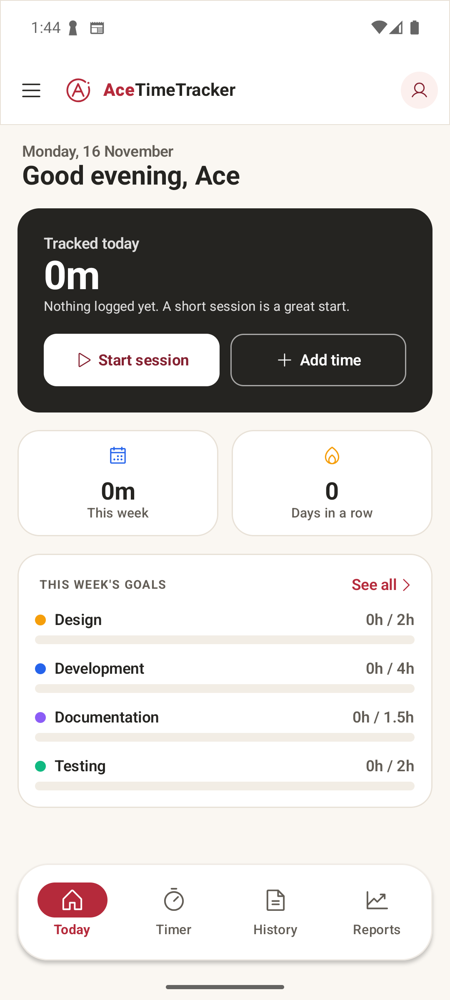
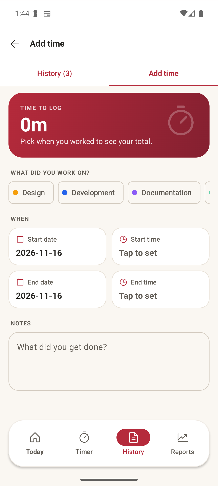
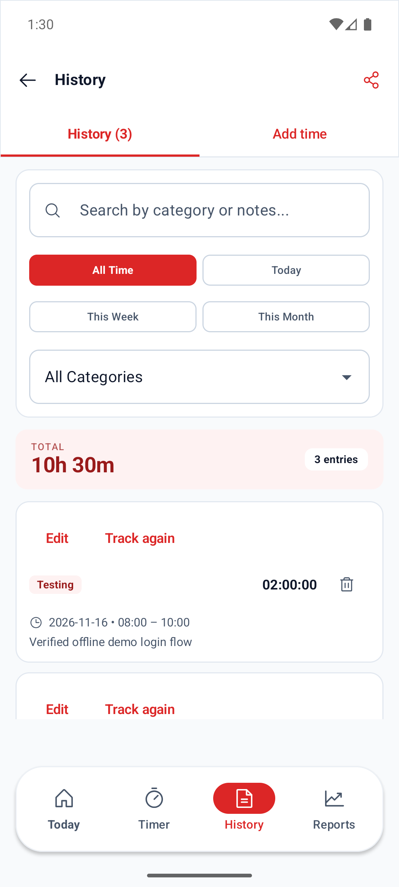
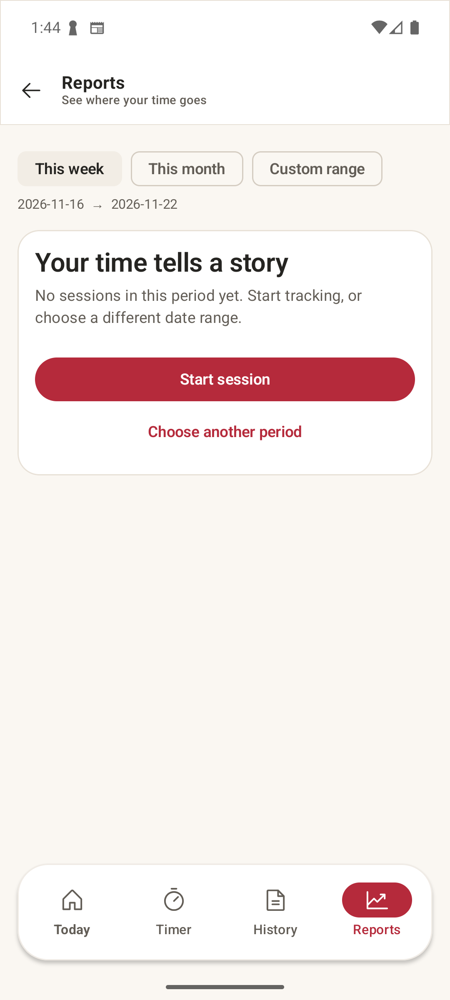

<p align="center">
  
</p>

<h1 align="center">AceTimeTracker</h1>
<p align="center">Track your work. Make time for what matters.</p>

<p align="center">
  <a href="https://github.com/MphoCodes/AceTimeTracker/actions/workflows/android.yml"></a>
  <a href="LICENSE"></a>
  
  
</p>

A native Android time tracker built with Kotlin and Jetpack Compose. Record a focused session or add time manually, organize it by category, and see where your week went.

## A look inside

<p align="center">
  
  
  
  
</p>

Screenshots show the updated November 2026 demo interface, including the empty report state. They are not evidence of a live backend or store release.

## What you can do

- **Track a session:** stopwatch or Pomodoro focus/break cycles, category selection, pause, reset, and save. Only focus time contributes to a Pomodoro entry.
- **Keep a timer draft:** switching primary tabs keeps the timer running, with a draft per account on the device. After process loss, the most recent checkpoint is restored paused; time after that checkpoint is not inferred.
- **Log time manually:** date-aware start/end validation, notes, and an optional photo.
- **Organize work:** create and edit colored categories and hour targets, favorite frequent categories, and delete categories while retaining historical entries. Renaming preserves existing session labels.
- **Review and correct history:** search and filter entries, edit dates/times/notes/photos, delete entries, or track a category again. Notes-only edits preserve recorded focus time.
- **Explore your time:** custom date ranges, previous-period comparisons, category targets, and a daily timeline with gaps, overlaps, and overnight clipping.
- **Share a report:** export CSV files or paginated PDFs through Android's share sheet. CSV fields are quoted and protected against spreadsheet formulas.
- **Keep work locally:** account-scoped SQLite storage saves entries and categories with a retryable outbox; the app shows pending sync and errors.
- **Track with fewer taps:** persistent main tabs, an active-session strip, pause/resume notification actions, a home-screen shortcut widget, and optional daily reminders on chosen weekdays.
- **Manage your profile:** email/password sign-in, registration, password reset, and profile details/photo.
- **Choose your appearance:** light, dark, or system theme.

## Try it locally

1. Clone the repository and open it in Android Studio.
2. Configure **JDK 21** and the SDK packages in the [development guide](docs/development.md).
3. Build and install the debug variant:

   ```sh
   ./gradlew :app:assembleDebug
   ./gradlew :app:installDebug
   ```

4. Use the **test sign-in** option on the login screen to explore with local sample data.

The demo does not need a live Firebase backend. Sample entries and categories persist locally across restarts. Demo profile data remains a sample, and no demo entries are uploaded. Timer drafts, favorites, and appearance preferences also persist locally. Test sign-in is disabled in release builds.

For real accounts, configure a Firebase project you control. The checked-in debug configuration is a placeholder; see [Firebase setup and data boundaries](docs/development.md#firebase-setup).

## Engineering

The app uses Compose Material 3 screens, a shared activity for the main tabs, ViewModels for screen state, and repositories backed by local SQLite storage and Firebase synchronization. Time is stored in milliseconds; the timer measures elapsed time with a monotonic clock. Dashboard and chart totals are derived from the same timesheet entries.

```text
app/src/main/java/com/mphocodes/acetimetracker/
├── data/model/        Categories, profiles, and timesheet entries
├── data/repository/   Authentication, repositories, settings, favorites
├── data/local/        Transactional SQLite records and outbox
├── data/sync/         Account-scoped synchronization and status
├── ui/activity/       Android lifecycle and navigation
├── ui/screen/         Compose screens
├── ui/components/     Shared controls and dialogs
├── ui/viewmodel/      Validation and screen state
├── ui/theme/          Color, typography, and theme preference
├── report/            Range calculations, timelines, PDF and CSV export
├── reminder/          Weekday schedules and inexact alarms
├── widget/            Home-screen timer shortcut
├── service/           Active timer notification
└── util/              Time calculations, CSV export, and result types
```

The project retains some XML layouts and adapters from its earlier UI. This is an incremental modernization, not a claim that every legacy component has been removed. See [architecture](docs/architecture.md).

## Build and verify

```sh
./gradlew --console=plain :app:testDebugUnitTest :app:lintDebug :app:assembleDebug
./gradlew --console=plain :app:lintRelease :app:assembleRelease :app:bundleRelease
```

GitHub Actions builds debug and release artifacts, runs local tests and lint, and retains reports. Device tests are a separate check:

```sh
./gradlew :app:connectedDebugAndroidTest
```

See [release preparation](docs/release.md) for output paths, optional signing, and remaining publication requirements. Builds are unsigned unless release signing is explicitly configured.

## Project status

The current time-tracking workflows are implemented. The November 2026 verification passed 90 local tests and 3 device tests, covering durable storage, account isolation, stale sync acknowledgments, timer recovery, editing, reminders, report calculations, and PDF/CSV export. Debug and release lint have no errors; legacy warnings remain. Device checks cover the demo workflow, not a live production backend.

Live Firebase ownership/rules, production authentication and media flows, account deletion, privacy disclosures, and store submission still require release-owner verification. There is no claim of a published Play release. The broader goals/routines roadmap in `docs/superpowers/` remains future work. Entry/category synchronization retries while the app process is alive and on authenticated relaunch; background execution after process death and offline photo uploads are not guaranteed. Local timestamps do not retain timezone identifiers.

## Contributing

Bug reports and focused pull requests are welcome. Start with [CONTRIBUTING.md](CONTRIBUTING.md), include reproduction steps, and keep screenshots free of personal data. Report security issues using [SECURITY.md](SECURITY.md).

Built by [Mpho Ndlela](https://github.com/MphoCodes). Licensed under the [MIT License](LICENSE).

## Development build downloads

Download the [development preview APK and checksums](https://github.com/MphoCodes/AceTimeTracker/releases/tag/v1.0.0-dev.20261116). This is a debug build for evaluation, not a production or Play Store release.

The [Android workflow](https://github.com/MphoCodes/AceTimeTracker/actions/workflows/android.yml) uploads a debug APK and separate unsigned release artifacts. Choose the debug APK for a development preview; unsigned release files are build outputs, not installable production distributions. GitHub artifact downloads require access to the workflow run. See [release preparation](docs/release.md) for signing and publication requirements.
